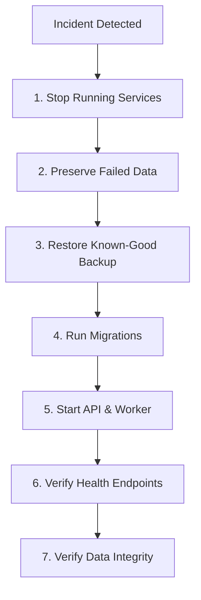

# Phase 17.4.10 — Disaster Recovery Runbook

## 1. Scope and Objective

This runbook defines the disaster recovery procedures for the AI Factory platform, specifically focusing on data preservation, backup policies, volume management, and step-by-step restoration for single-node containerized deployments.

### Target Recovery Objectives
- **Recovery Point Objective (RPO)**: 1 hour (subject to host-level backup schedule).
- **Recovery Time Objective (RTO)**: 15 minutes for service restoration from verified backup.

---

## 2. Protected Data Assets

The platform manages two categories of persistent state:

1. **Relational Database (`ai_factory_production_data`)**:
   - SQLite file: `/var/lib/ai-factory/data/factory.db` (including `-wal` and `-shm` files).
   - Contains: Project entities, task specifications, work items, execution steps, agent runs, approval decisions, audit logs, and lease records.
   - **Criticality**: Maximum. Data loss cannot be reconstructed automatically.

2. **Workspace & Artifact Storage (`ai_factory_production_workspace`)**:
   - Workspace directory: `/var/lib/ai-factory/workspace`
   - Contains: Git repositories, generated source code, project artifacts, diffs, build logs, and test results produced by coding agents.
   - **Criticality**: High. Contains intermediate code outputs and working trees.

---

## 3. Backup Strategy & Procedures

> [!NOTE]
> Automated continuous backup orchestration across cloud storage is an **infrastructure responsibility** (host/storage level). The application provides deterministic hooks and tools to ensure hot backups are transaction-safe.

### 3.1 Hot SQLite Backup Procedure

Because SQLite is running in Write-Ahead Logging (WAL) mode, copying `factory.db` directly without checkpointing can produce an inconsistent copy if a write is in-flight. Use the SQLite `.backup` API or CLI tool:

```bash
# Execute safe online hot backup from within the running API or Worker container:
docker compose exec api sqlite3 /var/lib/ai-factory/data/factory.db \
  ".backup '/var/lib/ai-factory/data/backups/factory-$(date +%Y%m%d_%H%M%S).db'"
```

Or execute directly on the host using Docker volume mounts:
```powershell
# Windows PowerShell host-level backup script
$timestamp = Get-Date -Format "yyyyMMdd_HHmmss"
$backupDir = "./backups"
New-Item -ItemType Directory -Force -Path $backupDir

# Create transactionally safe snapshot using sqlite3
docker compose exec -T api sqlite3 /var/lib/ai-factory/data/factory.db ".backup '/tmp/backup.db'"
docker compose cp api:/tmp/backup.db "$backupDir/factory_$timestamp.db"
docker compose exec -T api rm -f /tmp/backup.db
Write-Host "Database backup created at $backupDir/factory_$timestamp.db"
```

### 3.2 Volume Snapshot Schedule (Infrastructure Recommendation)
- **Hourly**: Local differential snapshot of `ai_factory_production_data`.
- **Daily**: Full backup of `ai_factory_production_data` and `ai_factory_production_workspace` exported to immutable remote/cloud storage.
- **Retention**: Keep hourly snapshots for 48 hours, daily backups for 30 days, weekly backups for 90 days.

---

## 4. Disaster Recovery & Restore Procedure

Follow this strict sequential procedure when restoring the platform following database corruption, hardware fault, or operational disaster.



### Step 1: Stop Affected Services
Halt all running containers to prevent concurrent writes or further state corruption:

```powershell
docker compose stop api worker
# Verify services are completely stopped
docker compose ps
```

### Step 2: Preserve Failed / Corrupted Data
Never overwrite failed state without preserving forensic evidence and potential rescue data:

```powershell
$timestamp = Get-Date -Format "yyyyMMdd_HHmmss"
$quarantineDir = "./quarantine_$timestamp"
New-Item -ItemType Directory -Force -Path $quarantineDir

# Copy existing volume data to quarantine
docker run --rm -v ai_factory_production_data:/data -v ${PWD}/$quarantineDir:/backup alpine \
  cp -a /data/. /backup/
Write-Host "Corrupted data quarantined to $quarantineDir"
```

### Step 3: Restore Known-Good Backup
Replace the active database volume contents with the verified backup file:

```powershell
$backupFile = "backups/factory_20260903_120000.db"

# Clear existing active database and copy backup
docker run --rm -v ai_factory_production_data:/data -v ${PWD}:/host alpine sh -c "
  rm -f /data/factory.db /data/factory.db-wal /data/factory.db-shm
  cp /host/$backupFile /data/factory.db
  chown 10001:10001 /data/factory.db
  chmod 660 /data/factory.db
"
```

### Step 4: Run Migrations
Run the dedicated migration container to ensure the restored database schema aligns with the current application release:

```powershell
docker compose run --rm migrator
# Confirm container exits with code 0 (success)
```

If the migration fails, stop and do not proceed to Step 5. Inspect migration logs for schema incompatibility.

### Step 5: Start API and Worker
Start the application services in normal dependency order:

```powershell
docker compose up -d api worker
```

### Step 6: Verify Health Endpoints
Verify all service health probes report healthy:

```powershell
# 1. API Liveness probe
curl -f http://localhost:8080/health/live

# 2. API Readiness probe (validates DB connectivity)
curl -f http://localhost:8080/health/ready

# 3. Worker Health Files inside container
docker compose exec worker sh -c "test -f /tmp/ai-factory-health/worker.ready && echo 'Worker Ready' || echo 'Worker NOT Ready'"
docker compose exec worker sh -c "test -f /tmp/ai-factory-health/worker.live && echo 'Worker Live' || echo 'Worker NOT Live'"
```

### Step 7: Verify Application Data Integrity
Verify business data accessibility via API:

```powershell
# Query projects list (requires OPERATIONAL_ACCESS_KEY if configured)
curl -H "X-Operational-Key: $env:OPERATIONAL_ACCESS_KEY" http://localhost:8080/api/projects

# Inspect database diagnostics
curl -H "X-Operational-Key: $env:OPERATIONAL_ACCESS_KEY" http://localhost:8080/api/operations/database
```

Confirm:
1. Projects, WorkItems, and execution history match expected backup timestamp.
2. Any runs that were `Running` during the crash are swept to `Pending` by `WorkflowRecoveryHostedService` within 60 seconds.
3. No lingering database locks exist.

---

## 5. Recovery Post-Mortem & Escalation

Upon successful restoration:
1. Log incident in audit records with root cause and restored snapshot ID.
2. Conduct post-incident review (PIR) within 24 hours.
3. Verify that scheduled backups resume and are healthy.
